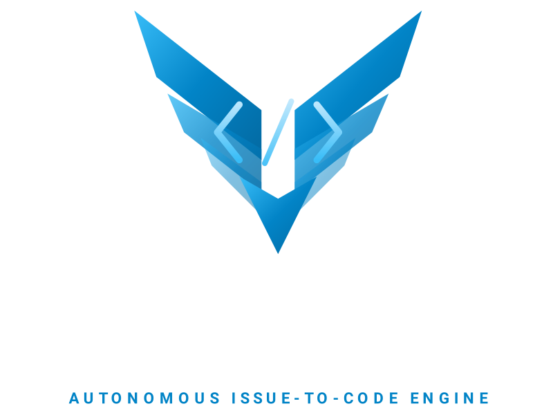

# Squadron

**A GitHub Actions template for a three-agent engineering workflow.**

Squadron turns labeled GitHub issues into a coordinated implementation, review, and test cycle. It uses issue labels for status tracking, so it does not require a GitHub Project.

## The workflow

1. **Start with an issue.** Choose a Feature, Technical task, or Bug form. Each form applies `status:todo`, which starts the coder automatically.
2. **Implement.** The coder updates relevant documentation, implements the issue, and opens a pull request.
3. **Review.** The reviewer checks the code and documentation against the issue. It queues the tester on approval or returns the same pull request to the coder when changes are needed.
4. **Test and merge.** The tester uses the issue as its requirements source, runs the configured test command, and squash-merges after success. A failure returns the pull request to the coder.

Issue status is tracked with `status:todo`, `status:in-progress`, `status:testing`, and `status:done`. Agent handoffs use `agent:coder`, `agent:reviewer`, and `agent:tester`.

## Get started

1. Use this repository as a template to create your product repository.
2. Add the `COPILOT_GITHUB_TOKEN` and `SQUADRON_GITHUB_TOKEN` secrets described in the [usage guide](USAGE.md).
3. Run **Actions → Squadron Setup** once to create the labels and check the secrets.
4. Create an issue from one of the forms to start the workflow. For manually created issues, add `status:todo` when the issue is ready.

If a step fails, Squadron comments with a link to the run and the label to re-apply to retry.

The repository includes issue forms for feature requests, technical tasks, and bugs. See [USAGE.md](USAGE.md) for setup details and [SQUADRON.md](SQUADRON.md) for template workflow and maintenance context.

## For generated products

This README describes the Squadron template. Replace it with your product's overview, setup, and usage when you create a product from this repository. Keep template-specific maintenance information in `SQUADRON.md`.
