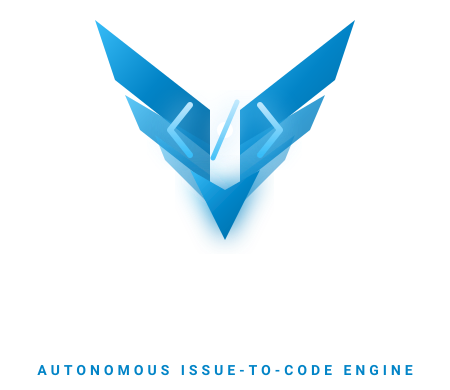

  
  
  

GitHub Actions pipelines for a three-role AI engineering workflow using issue labels, without a GitHub Project dependency.

## Setup

1. Create these repository secrets:
   - `COPILOT_GITHUB_TOKEN`: a token authorized to use GitHub Copilot. It is only provided to the Copilot CLI steps.
   - `SQUADRON_GITHUB_TOKEN`: a fine-grained token for this repository with **Contents**, **Pull requests**, **Issues**, and **Workflows** set to **Read and write**. Approve it for the organization if required. It is used for pull requests, labels, comments, pushes, and merges; the update workflow also needs **Workflows** permission to replace workflow files.
2. Run **Actions → Squadron Setup → Run workflow** once. It creates the `status:*` and `agent:*` labels and checks that both secrets are present and that `SQUADRON_GITHUB_TOKEN` can write to the repository.
3. Optionally set these repository variables when the defaults do not fit the product:
   - `SQUADRON_TEST_COMMAND`: defaults to `npm run test`.
   - `SQUADRON_TEST_PATHS`: comma-separated glob patterns for test files, defaulting to `**/*.test.*,**/*.spec.*` (test and spec files anywhere, including the repository root).
4. Configure branch protection and required checks as you like. When the tester's direct merge is blocked, for example by required checks still running on its test commit, it enables auto-merge instead, so turn on **Settings → General → Allow auto-merge** if you use required checks.

## Update from the template

Run **Actions → Squadron Update → Run workflow** to copy the latest Squadron files from the Squadron template's default branch.

1. The workflow first compares its own file (`.github/workflows/update.yml`) with the template's. If it changed, it commits the new version as `chore: update Squadron update workflow`, relaunches itself, and stops; the relaunched run performs the update with the new version.
2. Otherwise it copies the template files explicitly listed in the workflow (the Squadron issue forms, scripts, skills, and workflows under `.github/`, plus `SQUADRON.md`, `SQUADRON-CHANGELOG.md`, and `USAGE.md`), then commits and pushes the changes as `chore: update Squadron`. If those files already match, it does nothing.

The listed files are overwritten, so customizations in them will be lost. Other files, including your own files under `.github/` and `README.md`, are left unchanged. Files removed from the template are not deleted from your repository.

See the [changelog](SQUADRON-CHANGELOG.md) to find all the available updates.

## Workflow

1. Create an issue from the Feature, Technical task, or Bug form. The form applies `status:todo`, which starts the coder. For other issues, add `status:todo` when the issue is ready. The `squadron-requirements-helper` Copilot skill helps draft an issue that passes the coder's requirements check.
2. The coder sets `status:in-progress` and checks that the issue's requirements and scope are complete. If something blocking is missing, it comments the questions on the issue and puts it back to `status:todo` without implementing anything: answer them in the issue body (agents do not read comments), then remove and re-apply `status:todo`. Otherwise it implements the issue, updates relevant documentation, opens a pull request from `squadron/issue-<number>` that contains `Closes #<number>`, and queues review with `agent:reviewer`.
3. The reviewer checks the code and documentation against the issue and posts a verdict comment. On approval the issue becomes `status:testing` and the PR gets `agent:tester`; otherwise the issue returns to `status:in-progress` and the PR gets `agent:coder`. The coder then fixes the same PR and queues another review.
4. The tester uses only the issue title and body as its requirements source. It adds or updates tests matching `SQUADRON_TEST_PATHS`, makes sure `SQUADRON_TEST_COMMAND` works (adding a missing npm script or test dependency if needed), and never weakens tests or changes product code. The workflow then reinstalls dependencies and runs the command as the merge gate. On success it squash-merges the PR; on failure it comments the last 80 log lines, returns the issue to `status:in-progress`, and queues the coder.
5. When the PR is merged, the issue becomes `status:done`.

The reviewer verdict is a pull request comment, not a GitHub approval review. Branch protection and required checks remain authoritative.

## When something fails

Every failed run comments on the issue or pull request with a link to the run. To retry, re-apply the label named in the comment: `status:todo` on the issue for the coder, or `agent:coder`, `agent:reviewer`, or `agent:tester` on the pull request.

Only pull requests from `squadron/issue-<number>` branches in this repository are automated. Pull requests you open yourself are left alone.
